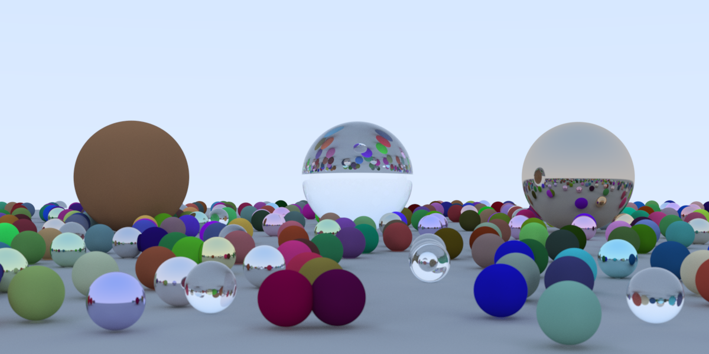
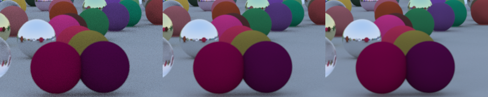

# raytracing-nim
raytracing in a weekend with nim

## Branch `optimized`

`main.nim` here is laid out as
[raytracing-goose](https://github.com/aguspiza/raytracing-goose), and writes
the same `ray.tga` as it and as
[raytracing-bend2](https://github.com/aguspiza/raytracing-bend2), byte for byte.



1024 samples per pixel, 92 s on 16 threads. The noise falls with the square
root of the samples; the same patch at 64, 256 and 1024 samples, zoomed 2x:



What the branch changes:

- the random numbers of the Bend port (a xorshift32 state seeded per pixel),
  so all three render the same image;
- the spheres as four flat `float32` arrays, and a hit test in two passes: the
  first has no branches and gcc vectorizes it with AVX, the second takes the
  `sqrt` only for the spheres the ray can hit;
- worker threads take rows from an atomic counter and send each finished row
  back on a `Channel`;
- `config.nims` builds with `-d:danger --panics:on --passC:-march=native`.
  `--panics:on` is worth 15%: without it, every call is followed by a check of
  the thread-local error flag. `main.nim` turns off fused multiply-add, or a few
  pixels would differ from the Goose and Bend images in the low bits.

```
nim c -o:ray main.nim
./ray                  # 64 samples per pixel -> ray.tga
./ray 16 ppm           # 16 samples per pixel, also write ray.ppm
./ray 16 --threads 1   # cap the worker threads (default: every CPU)
./test.sh              # checks the image against the Goose and Bend one
```

1200x600, WSL2 on a 16-thread Ryzen 7 5700U, Nim 2.2.10 and gcc 13.3,
median of 3 runs:

| 4 samples per pixel          | This branch | Goose  | `fix-threads-and-cross` |
| ---------------------------- | ----------- | ------ | ----------------------- |
| 1 thread                     | 2.2 s       | 2.2 s  | 18.9 s                  |
| 16 threads                   | 0.38 s      | 0.34 s | 3.2 s                   |
| 64 samples, 16 threads       | 5.6 s       | 5.9 s  | 52.5 s                  |
| Peak RAM                     | 11 MB       | 6 MB   | 14 MB                   |
| Build, clean (compiler RAM)  | 2.2 s (89 MB) | 0.9 s (60 MB) | 2.3 s (87 MB) |
| Binary, stripped             | 93 KB       | 47 KB  | 134 KB                  |

Writing each row straight into the image through a
`ptr UncheckedArray[Rgb]` instead of the channel saves under 3%, within the
noise between runs.

http://www.realtimerendering.com/raytracing/Ray%20Tracing%20in%20a%20Weekend.pdf

## Performance

After some some benchmarking, using nimprof help me find some problem with `Option[T]` return type.
Refactoring to a simple tuple `(bool, T)` resulted in a 3.5x performance improvement.

### C backend
```
raytracing-nim $ time nim c --run -f -d:nsamples=100 -d:showProgress -d:release main
...
Hint: operation successful (46999 lines compiled; 2.673 sec total; 71.785MiB peakmem; Release Build) [SuccessX]
Hint: /media/agus/3TB/agus/coding/nim/raytracing-nim/main  [Exec]
99                 
real    0m54.468s
user    0m55.465s
sys     0m0.416s
```

### C backend (multithread)

```
raytracing-nim $ time nim c --run --threads:on -f -d:nsamples=100 -d:showProgress --threadAnalysis:off -d:release main
...
Hint: operation successful (53314 lines compiled; 2.921 sec total; 72.723MiB peakmem; Release Build) [SuccessX]
Hint: /media/agus/3TB/agus/coding/nim/raytracing-nim/main  [Exec]
99                 
real    0m34.527s
user    1m9.209s
sys     0m1.572s
```

### C++ backend

```
raytracing-nim $ time nim cpp --run -f -d:nsamples=100 -d:showProgress -d:release main
...
Hint: operation successful (46999 lines compiled; 2.792 sec total; 71.875MiB peakmem; Release Build) [SuccessX]
Hint: /media/agus/3TB/agus/coding/nim/raytracing-nim/main  [Exec]
99                 
real    0m59.046s
user    1m0.203s
sys     0m0.392s
```

### C++ backend (multithread)
```
raytracing-nim $ time nim cpp --run --threads:on -f -d:nsamples=100 -d:showProgress --threadAnalysis:off -d:release main
...
Hint: operation successful (53314 lines compiled; 3.168 sec total; 72.695MiB peakmem; Release Build) [SuccessX]
Hint: /media/agus/3TB/agus/coding/nim/raytracing-nim/main  [Exec]
99                 
real    0m37.762s
user    1m15.127s
sys     0m1.783s
```

### Rust comparison (multithread)
```
rust/raytracing $ time cargo run --release
...
:: Generating the scene
:: Generating the image
:: Writing the image

real	0m32.001s
user	1m33.092s
sys	0m2.140s

```